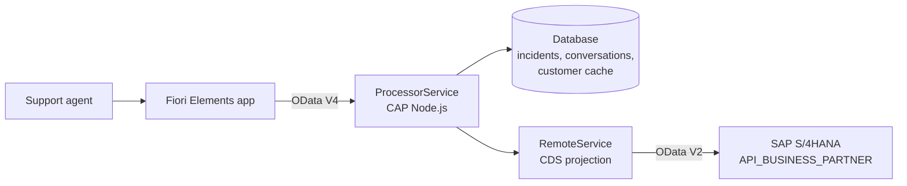
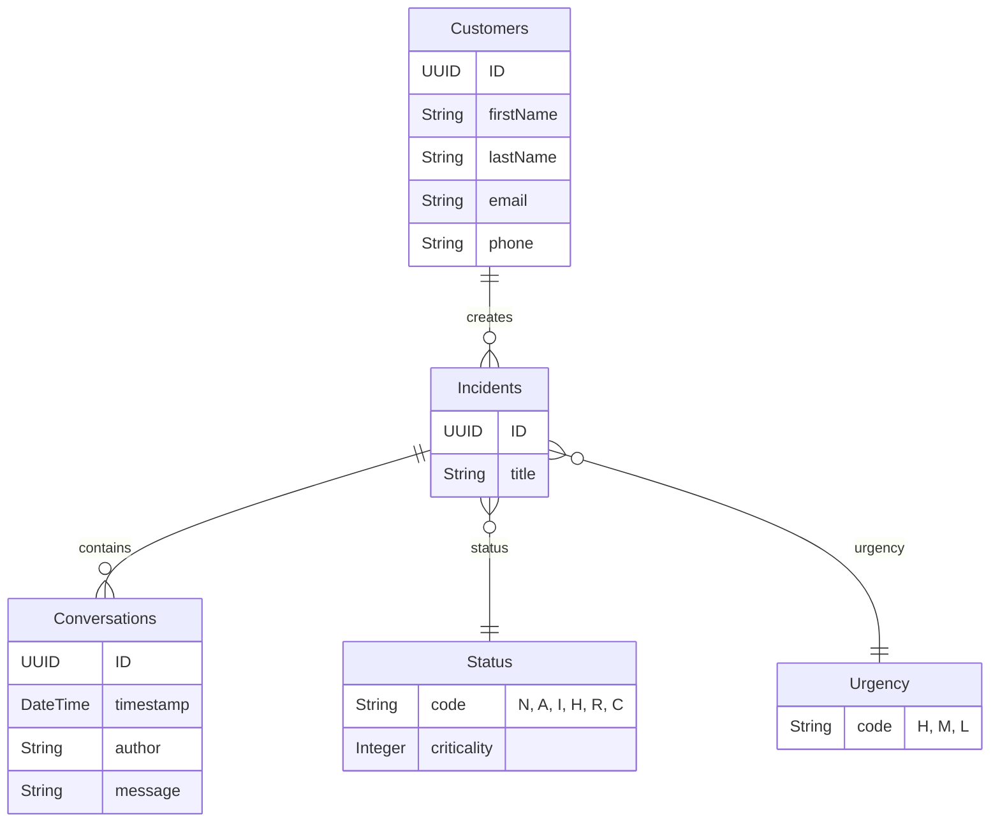

# Incident Management

**SAP CAP application with SAP Fiori Elements and SAP S/4HANA Business Partner integration**

A support team receives incidents from customers: a solar inverter that stops working, no current on a sunny day. This app lets support agents create, track and process those incidents, keep the conversation history with the customer, and work with customer data coming directly from SAP S/4HANA.

The project is based on SAP's reference *Incident Management* scenario, which I extended with custom business logic, an S/4HANA Business Partner integration and automated tests.

Built with **SAP CAP (Node.js)**, **SAP Fiori Elements (OData V4)** and the **SAP S/4HANA Business Partner API**.

---

## Features

- **Incident list and detail page** (Fiori Elements List Report and Object Page), filterable by status and urgency
- **Draft editing**: agents can edit an incident over several steps and save it only when it's ready
- **Conversation history** for each incident, with author and timestamp filled automatically
- **Business rules**:
  - an incident whose title contains *"urgent"* is automatically set to **High** urgency
  - a **closed** incident can no longer be modified
- **Customers from SAP S/4HANA**: the customer value help reads Business Partners from S/4HANA, and when an incident is saved, the selected customer's name, email and phone are copied locally
- **Role-based access**: `support` for agents (`ProcessorService`), `admin` for administrators (`AdminService`)

---

## Architecture



| Layer | Technology | Role |
|---|---|---|
| UI | SAP Fiori Elements (List Report + Object Page) | Screens generated from CDS annotations |
| Backend | SAP CAP (Node.js), OData V4 | Data model, services, draft handling, business rules |
| Integration | CAP remote service + SAP Cloud SDK | Consumes the S/4HANA Business Partner API |
| Database | SQLite (local) | Incidents, conversations, cached customers |

---

## Design choices

**A clean interface over the S/4HANA API.** The Business Partner API (`API_BUSINESS_PARTNER`) is imported from its official EDMX definition. `RemoteService` then exposes only the fields the app needs, with readable names (`BusinessPartner` → `ID`, `BusinessPartnerName` → `name`), and navigates to addresses, emails and phone numbers through associations.

**Read live, cache on save.** The customer value help reads Business Partners live from S/4HANA, so agents always see current data. When an incident is created or updated, the selected customer is copied into the local `Customers` table (`UPSERT`), so the incident list doesn't need to call S/4HANA for every row.

**Business rules in the service layer.** CAP event handlers (`before CREATE`, `before UPDATE`) enforce the rules on the server, whatever the client: the urgency rule and the protection of closed incidents.

**Mocked S/4HANA for development.** Locally, CAP mocks the Business Partner API with sample data (`srv/external/data`), so the app runs without any S/4HANA system.

---

## Data model



---

## Project structure

```
incidents-management-app/
├── app/
│   ├── incidents/
│   │   ├── annotations.cds        # Fiori Elements UI annotations
│   │   └── webapp/                # Fiori app (manifest, component, OPA test journeys)
│   └── launchpage.html            # Local launchpad
├── db/
│   ├── schema.cds                 # Customers, Incidents, Conversations, Status, Urgency
│   └── data/                      # Sample data
├── srv/
│   ├── services.cds               # ProcessorService (support) and AdminService (admin)
│   ├── services.js                # Business rules and S/4HANA integration
│   ├── remote.cds                 # RemoteService: projection of the Business Partner API
│   └── external/                  # Imported API_BUSINESS_PARTNER definition and mock data
└── tests/
    └── test.js                    # API tests (cds.test + Jest)
```

---

## Run locally

Requirements: Node.js 20+, `@sap/cds-dk` installed globally.

```bash
npm install
npm run watch-incidents
```

The app opens in the browser. Locally, the S/4HANA API is mocked and these test users are available:

| User | Password | Role |
|---|---|---|
| `alice` | *(empty)* | support |
| `bob` | *(empty)* | support |
| `incident.support@tester.sap.com` | `initial` | support |

To try the business rules:
1. Create an incident with *"Urgent"* in the title: its urgency is set to **High** on save.
2. Set an incident's status to **Closed**, save it, then try to edit it again: the change is refused.

---

## Tests

```bash
npm test
```

The tests run the service in memory with the mocked S/4HANA API, and cover:
- reading incidents and customers
- the full **draft lifecycle**: create a draft, activate it, edit it again, activate the changes
- the **urgency rule** (an "urgent" title gives High urgency)
- the **closed incident rule** (re-opening a closed incident is refused)
- deleting an incident

---

## Next steps

- Deploy to SAP BTP Cloud Foundry (MTA, SAP HANA Cloud, XSUAA, Destination to S/4HANA)
- Track a service level agreement (SLA) per urgency and flag overdue incidents
- Notify the support team when a high-urgency incident is created

---

## Author

**Amin Mesmoudi**
[LinkedIn](https://www.linkedin.com/in/aminmesmoudi13/) · [GitHub](https://github.com/mmed9min)
